

  

  <b>You set the lineup. Your squad does the fighting.</b> 
  <a href="https://play.google.com/store/apps/details?id=game.scrapparade.app"><b>▶ Get it on Google Play</b></a>
  &nbsp;·&nbsp; <a href="https://github.com/nuuse/ScrapParade-builds/releases/latest"><b>⬇ Windows download</b></a>
  &nbsp;·&nbsp; <a href="#gallery">Gallery</a>
  &nbsp;·&nbsp; <a href="#feedback">Feedback</a>
  &nbsp;·&nbsp; <a href="#deutsch">Deutsch</a>

  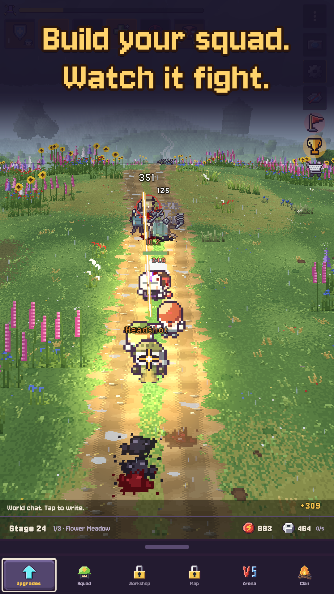
  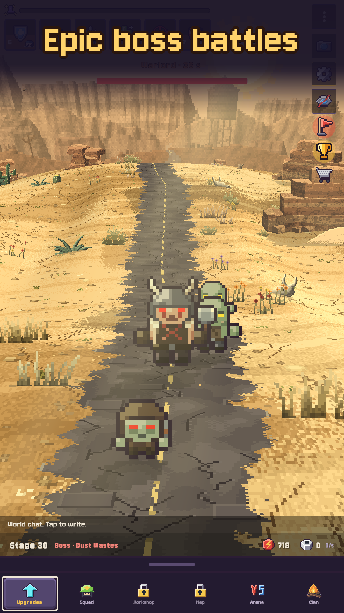
  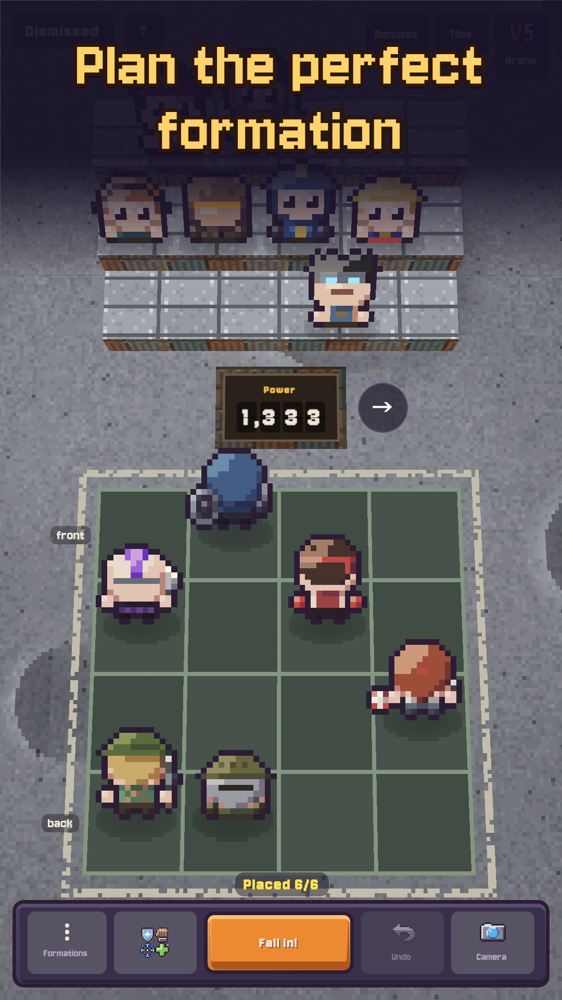

> **Scrap Parade is out on [Google Play](https://play.google.com/store/apps/details?id=game.scrapparade.app)!** On Android, get it there. This page keeps the Windows version, which plays on the same servers as Google Play. The game is still growing, so expect regular updates.

## The parade marches on

A post-apocalyptic **squad auto-battler**. You pick your fighters and decide who stands where. Then the parade marches off on its own, fights whatever steps onto the road and drags the scrap home. Check in for a minute to collect, upgrade and shuffle the lineup, or stick around and go for the next boss.

- **The lineup decides.** Tanks, melee, ranged and support, each with their own gear and skill. Your squad grows from 2 up to 10 fighters. On the parade ground it matters who stands next to whom: neighbours buff each other. Save your favourite lineups and swap them in a tap.
- **Auto-battle, but you get a say.** Fire skills yourself at the right moment, or leave it to the squad.
- **Always something to upgrade.** Loot in several rarities, recruiting, research, a workshop, and drones that join the fight.
- **The wasteland doesn't sit still.** Eight biomes with many variants, day and night, storms and sandstorms, forks in the road. Sometimes an oasis. Sometimes a junkyard full of wrecks.
- **Not alone out there.** Arena duels against other players' squads, rankings and clans.
- **Idle means idle.** The squad keeps walking while you're away.

## Gallery

  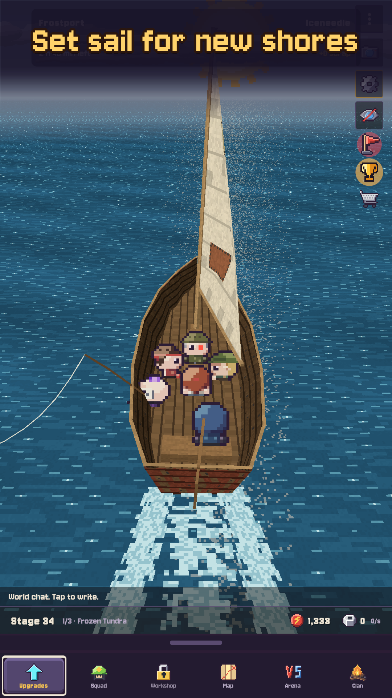
  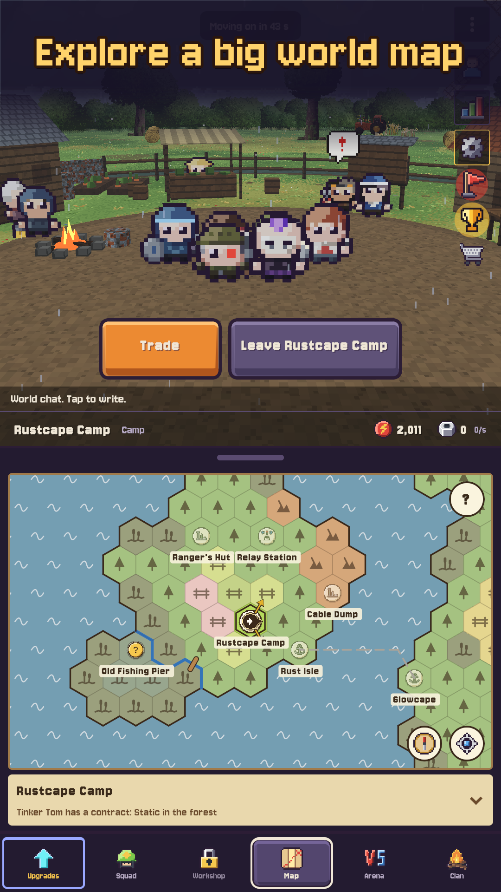
  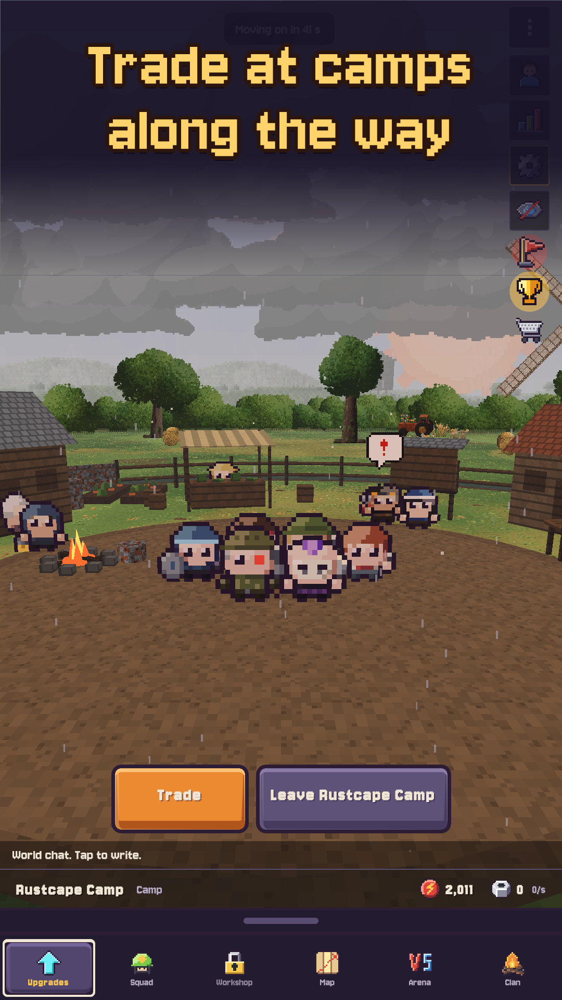
  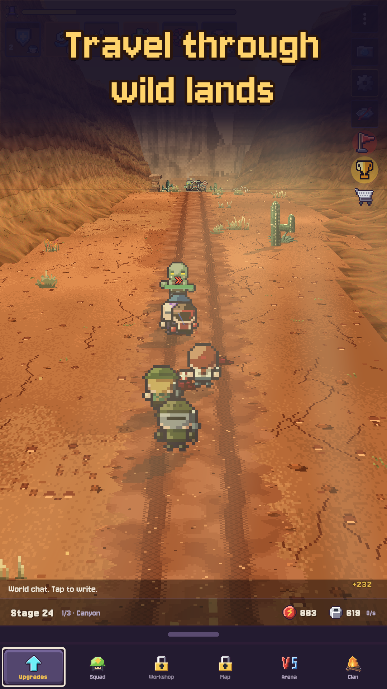

  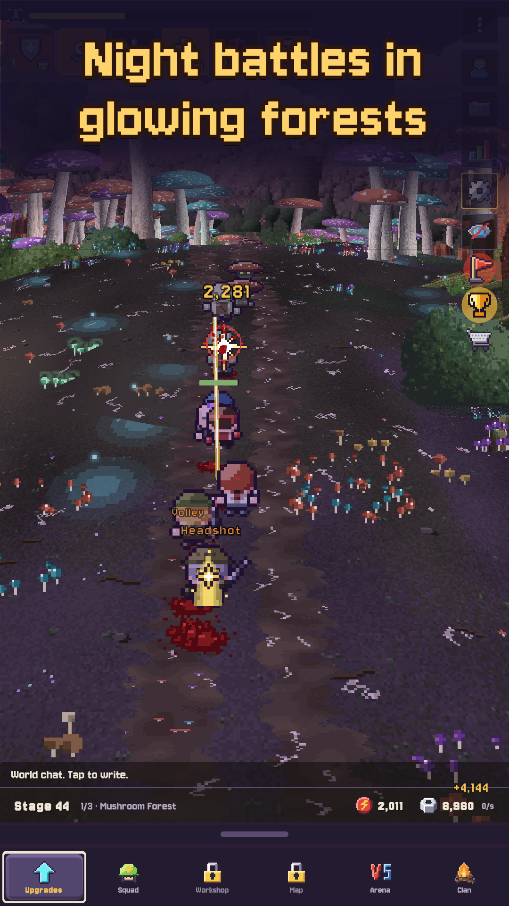
  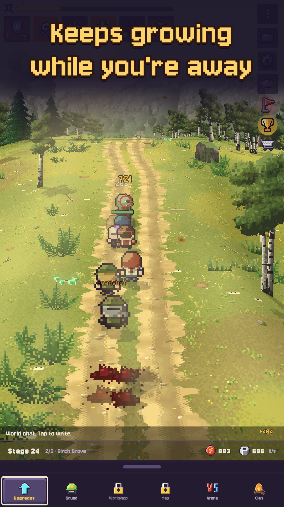
  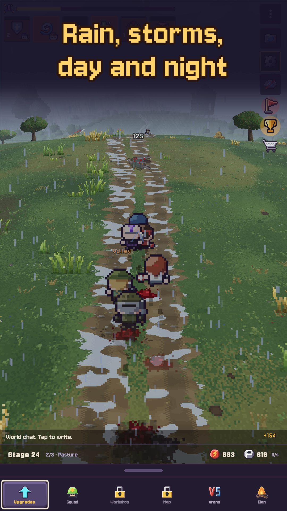
  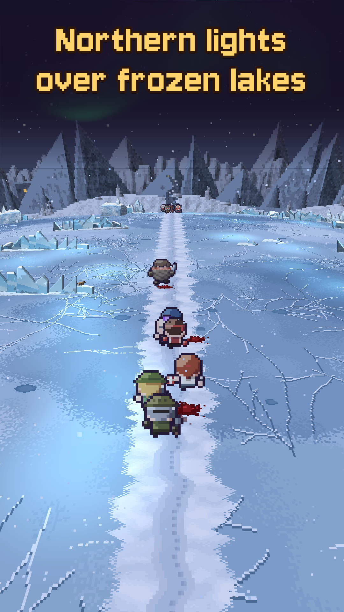

<i>Made for your phone</i>

  
  

<i>Every boss has its own attack · Ferry rides between the regions</i>

  
  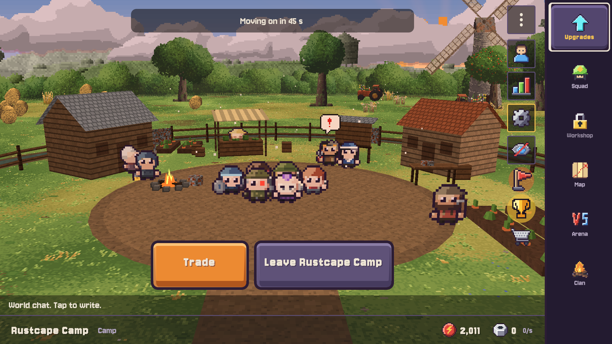

<i>Pick your route on the world map · Trade at camps along the way</i>

  
  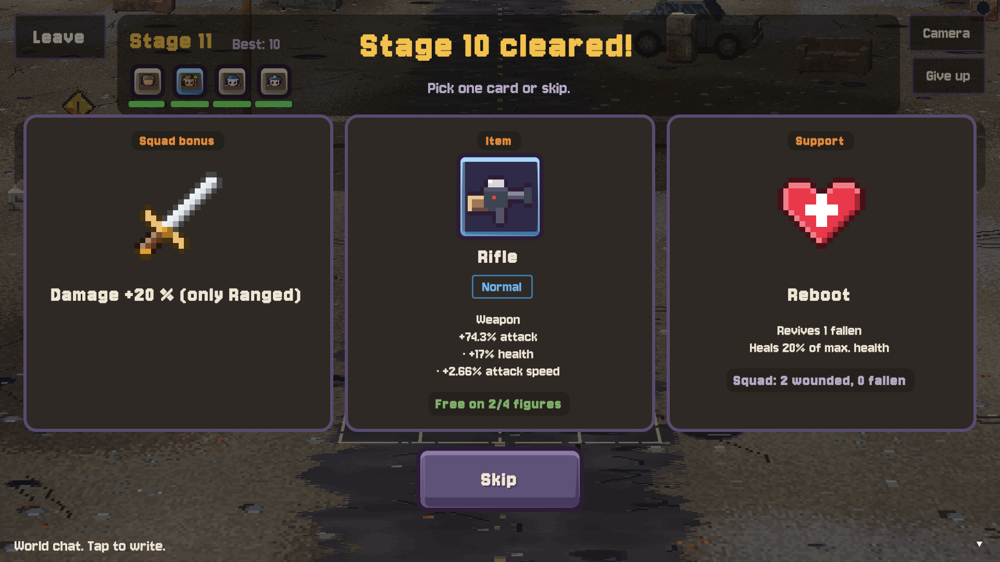

<i>Parade ground: neighbours buff each other · Event runs: a new card every stage</i>

  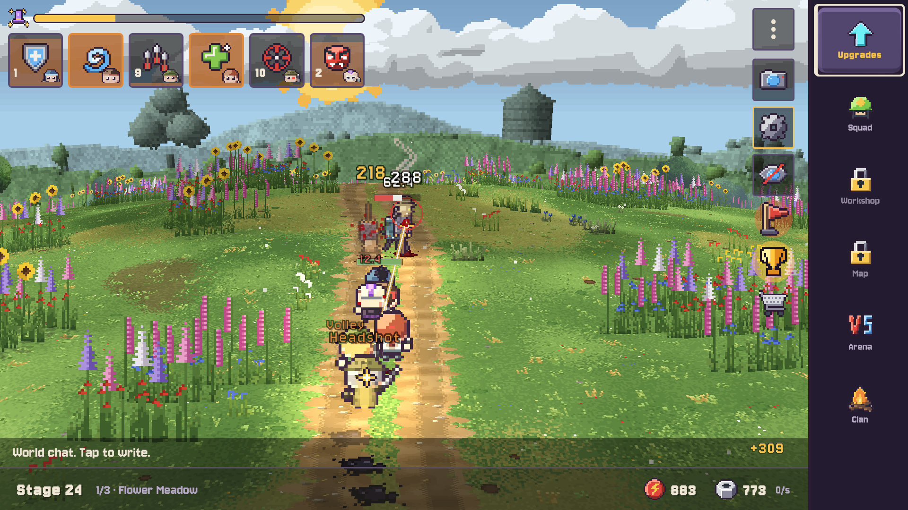
  

  
  

  
  

<i>Many biomes with day and night, rain and storms</i>

## How to play

**Android** (7.1 or newer, 64 bit): **[Scrap Parade on Google Play](https://play.google.com/store/apps/details?id=game.scrapparade.app)**.
An old playtest APK keeps working with your playtest progress, but it gets no more updates.

**Windows** (64 bit, Windows 10 or 11): grab the newest version from the **[Releases page](https://github.com/nuuse/ScrapParade-builds/releases/latest)**.
1. Download `ScrapParade-<version>.zip` and unpack it into a folder of its own.
2. Run `ScrapParade.exe`. Windows may warn you because the file isn't signed: click *More info*, then *Run anyway*.
3. Done. When a new version is out, the game asks at start, updates itself and restarts. Your progress stays.

Since the launch on 22 November 2026, the Windows version plays on the same servers as Google Play and started fresh there.

Online features (cloud save, chat, arena, clans) need a sign-in. Details in the [privacy policy](https://nuuse.github.io/scrapparade-legal/privacy.html).

## What's new

Each version's changes are listed with its release. The Windows version gets regular updates, and your progress stays.

Every version with its notes: **[all releases](https://github.com/nuuse/ScrapParade-builds/releases)**.

## Feedback

The game isn't finished. That's the point of testing it, and why your notes help.

- **Something broke?** In the game: *Settings → Report an error*. It sends the error log and your game version. Add a line on what happened if you like.
- **Anything else?** What annoys you, what's unclear, what's missing, what's fun: post it on **[Discord](https://discord.gg/zAbupYqpde)** or tell the person who sent you this link.
  Short notes are perfect ("boss 2 felt impossible", "couldn't find the workshop").

**Download, play a few runs, tell us what you think.** Thanks for testing!

<a href="https://play.google.com/store/apps/details?id=game.scrapparade.app"><b>▶ Get it on Google Play</b></a> &nbsp;·&nbsp; <a href="https://github.com/nuuse/ScrapParade-builds/releases/latest"><b>⬇ Windows download</b></a>

---

## Deutsch

**Du stellst auf. Dein Squad kämpft.**

Scrap Parade ist ein **Squad-Auto-Battler** nach dem Weltuntergang. Du wählst deine Kämpfer und legst fest, wer wo steht. Dann zieht die Parade von selbst los, legt sich mit allem an, was auf der Straße steht, und schleppt den Schrott heim. Kurz reinschauen, einsammeln, aufrüsten, die Aufstellung umbauen. Oder dabeibleiben und den nächsten Boss knacken. Bilder gibt es in der [Galerie](#gallery).

### So spielst du

Scrap Parade ist **[im Google Play Store](https://play.google.com/store/apps/details?id=game.scrapparade.app)** erschienen.

**Android** (ab 7.1, 64 Bit): **[Scrap Parade bei Google Play](https://play.google.com/store/apps/details?id=game.scrapparade.app)**.
Eine alte Playtest-APK läuft mit deinem Playtest-Spielstand weiter, bekommt aber keine Updates mehr.

**Windows** (64 Bit, Windows 10 oder 11): die neueste Version liegt auf der **[Releases-Seite](https://github.com/nuuse/ScrapParade-builds/releases/latest)**.
1. `ScrapParade-<Version>.zip` herunterladen und in einen eigenen Ordner entpacken.
2. `ScrapParade.exe` starten. Windows warnt eventuell, weil die Datei nicht signiert ist: *Weitere Informationen*, dann *Trotzdem ausführen*.
3. Fertig. Gibt es eine neue Version, fragt das Spiel beim Start, aktualisiert sich selbst und startet neu. Dein Spielstand bleibt erhalten.

Seit dem Start am 22. November 2026 spielt die Windows-Version auf denselben Servern wie Google Play und hat dort neu angefangen.

Online-Funktionen (Cloud-Spielstand, Chat, Arena, Clans) brauchen eine Anmeldung. Details in der [Datenschutzerklärung](https://nuuse.github.io/scrapparade-legal/privacy.html).

### Was ist neu

Neue Versionen und ihre Änderungen stehen jeweils bei den Releases. Die Windows-Version bekommt regelmäßig Updates, Spielstände bleiben erhalten.

Alle Versionen mit Änderungen: **[alle Releases](https://github.com/nuuse/ScrapParade-builds/releases)**.

### Feedback

- **Etwas kaputt?** Im Spiel: *Einstellungen → Fehler melden*. Das schickt das Fehlerprotokoll und deine Version mit. Wenn du magst, schreib kurz dazu, was passiert ist.
- **Alles andere?** Was nervt, was unklar ist, was fehlt, was Spaß macht: Schreib es auf **[Discord](https://discord.gg/zAbupYqpde)** oder sag es der Person, die dir den Link geschickt hat.
  Kurze Notizen reichen völlig („Boss 2 war nicht zu schaffen“, „Werkstatt nicht gefunden“).

**Runterladen, ein paar Runden spielen, Bescheid sagen.** Danke fürs Testen!

<!-- Stand: 2026-11-22 (Store-Release; Vorlage im Hauptrepo docs/playtest-page/README_STORE.md) -->
